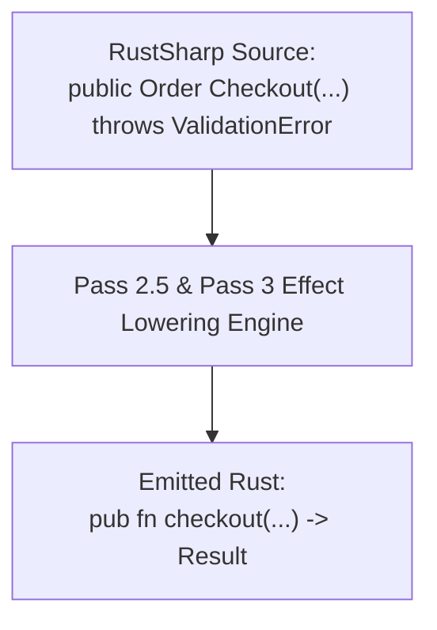

# Under the Hood of RustSharp: Blog 07
# Taming the Exception Monster — Checked Effects to Result<T, E> and ?

> *Part 7 of the 12-part technical series "Under the Hood of RustSharp: From C# Ergonomics to Pure Zero-Cost Rust"*

---

## 1. The Catastrophe of Runtime Exceptions

In traditional .NET and C# programming, error handling is dominated by unchecked runtime exceptions (`throw new InvalidOperationException(...)`).

While exceptions are syntactically convenient, they represent a disaster for high-performance systems software:
1. **Hidden Control Flow:** Looking at a C# method signature `public User GetUser(string id)`, there is no way to know what exceptions it might throw without reading its source code or relying on outdated XML comments.
2. **Brutal Performance Penalties:** Throwing an exception in .NET forces the runtime to capture the call stack, walk stack frames, and unwind memory, incurring microsecond-level latency spikes.
3. **Safety Hazards:** In systems programming, unexpected stack unwinding can leave locks poisoned, network connections half-open, and transactional buffers in inconsistent states.

In Rust, **exceptions do not exist**. Rust models recoverable errors explicitly using the `Result<T, E>` algebraic enum, propagated using the elegant `?` try-operator:

```rust
pub fn get_user(id: &str) -> Result<User, DbError> {
    let row = query_database(id)?;
    Ok(User::from_row(row))
}
```

How does RustSharp bridge this fundamental gap without forcing developers to abandon C#'s clean error-handling ergonomics?

The answer is RustSharp's **Checked Effect System (`throws E`)**.

---

## 2. The Checked Effect System: `throws E`

RustSharp introduces explicit effect signatures into the C# grammar. When a method can produce a recoverable error, it declares its failure mode explicitly:

```csharp
public class OrderService {
    public Order Checkout(Cart cart) throws ValidationError, PaymentError {
        if (cart.Items.Count == 0) {
            throw new ValidationError("Cart cannot be empty");
        }
        var receipt = this.paymentGateway.Charge(cart.Total);
        return new Order(cart, receipt);
    }
}
```



### Compile-Time Effect Enforcement
If a method calls another method that declares `throws E`, the caller must either:
1. Catch the error using a `try-catch` block.
2. Re-declare `throws E` in its own signature to allow propagation.

If an unhandled fallible call is detected, the RustSharp compiler rejects the code at compile time with pinpoint span accuracy:
```text
ERROR [RSHARP000] at src/Services/OrderService.rsharp:22:9:
Unhandled effect 'PaymentError' from call to 'Charge'.
Must be caught in try-catch or declared in enclosing method signature.
```

---

## 3. Lowering `throw` to `return Err(...)`

When `throw new E(...)` is encountered inside a fallible method, Pass 3 lowers it directly into an early return of a `Result::Err`:

### RustSharp Source:
```csharp
if (order.Total <= 0.0m) {
    throw new ValidationError("Total must be positive");
}
```

### Generated Rust Output:
```rust
if order.total <= Decimal::new(0, 1) {
    return Err(ValidationError::new("Total must be positive"));
}
```

There is **zero stack unwinding, zero runtime capture overhead, and zero heap allocation**. It is compiled down to a simple integer comparison and branch instruction by LLVM.

---

## 4. Automatic `?` Operator Injection

When calling a fallible method from another fallible method that shares the same error type (or a compatible error union), RustSharp automatically injects the native Rust `?` operator:

### RustSharp Source:
```csharp
public Order ProcessOrder(Cart cart) throws OrderError {
    var validatedCart = this.validator.Validate(cart); // May throw OrderError
    return this.storage.Save(validatedCart);           // May throw OrderError
}
```

### Generated Rust Output:
```rust
pub fn process_order(&self, cart: &Cart) -> Result<Order, OrderError> {
    let validated_cart = self.validator.validate(cart)?;
    let saved_order = self.storage.save(&validated_cart)?;
    Ok(saved_order)
}
```

Notice how clean the generated Rust is:
- The return type was automatically wrapped in `Result<Order, OrderError>`.
- The calls to `validate` and `save` were appended with `?`.
- The successful terminal return was wrapped in `Ok(...)`.

---

## 5. Lowering `try-catch` to Native Pattern Matching

When client code catches an exception, RustSharp transforms the `try-catch` block into a zero-cost Rust `match` expression:

### RustSharp Source:
```csharp
public decimal GetDiscount(string coupon) {
    try {
        var rule = this.couponService.Lookup(coupon);
        return rule.DiscountPercent;
    } catch (CouponError err) {
        Console.WriteLine(err.Message);
        return 0.0m;
    }
}
```

### Generated Rust Output:
```rust
pub fn get_discount(&self, coupon: &str) -> Decimal {
    match self.coupon_service.lookup(coupon) {
        Ok(rule) => rule.discount_percent,
        Err(err) => {
            println!("{}", err.message);
            Decimal::new(0, 1)
        }
    }
}
```

The exception is handled as a standard CPU branch. If an error occurs:
- The error payload is extracted immediately into `err`.
- No GC allocations or runtime unwinding handlers are ever registered.
- In happy-path execution, the CPU branch predictor breezes through with near-zero overhead.

---

## 6. Summary & What's Next

By replacing runtime exceptions with checked effects:
- Developers enjoy clear, self-documenting method signatures.
- Errors are verified exhaustively at compile time.
- Emitted Rust uses idiomatic, zero-cost `Result<T, E>` and `?` operators.

In **[Blog 08: The Secret Sauce — Fusing LINQ into Zero-Cost Rust Iterators](08_the_secret_sauce_fusing_linq_into_rust_iterators.md)**, we examine how RustSharp transforms C#'s declarative LINQ queries into high-performance, SIMD-vectorized Rust iterator chains without allocating intermediate collections.

