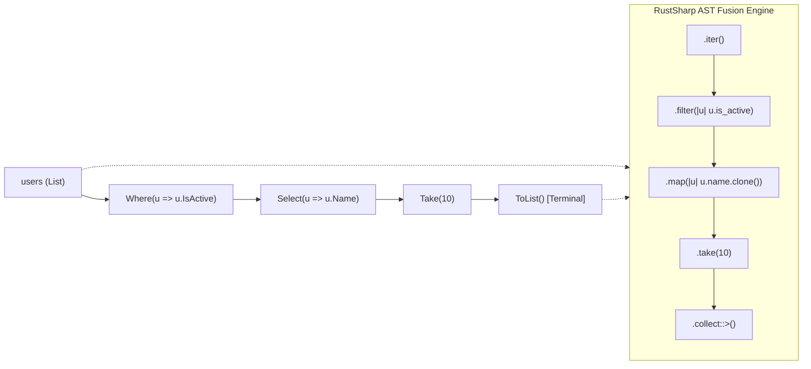

# Under the Hood of RustSharp: Blog 08
# The Secret Sauce — Fusing LINQ into Zero-Cost Rust Iterators

> *Part 8 of the 12-part technical series "Under the Hood of RustSharp: From C# Ergonomics to Pure Zero-Cost Rust"*

---

## 1. The LINQ Dilemma: Declarative Beauty vs Heap Allocations

Language Integrated Query (LINQ) is widely considered one of the finest language features ever invented. It allows developers to express complex data transformations declaratively:

```csharp
var activeUserNames = users
    .Where(u => u.IsActive)
    .OrderBy(u => u.CreatedAt)
    .Select(u => u.Name.ToUpper())
    .Take(10)
    .ToList();
```

In standard .NET:
- Every chained LINQ method creates an `IEnumerable<T>` state machine or enumerator object.
- Lambda expressions (`u => u.IsActive`) often allocate delegate instances (`Func<User, bool>`) and closure objects on the heap.
- In hot performance paths, these allocations flood the garbage collector's Gen 0 generation, triggering GC pauses.

In Rust, the standard library provides **Iterator Adaptors** (`.iter()`, `.filter()`, `.map()`, `.take()`, `.collect()`). Rust iterators are famous for being **zero-cost abstractions**: LLVM can aggressively unroll loops, eliminate boundary checks, and auto-vectorize operations into single-instruction multiple-data (SIMD) CPU instructions.

The goal of RustSharp is simple: **take standard C# LINQ syntax and fuse it directly into zero-cost Rust iterator pipelines with zero runtime allocation**.

In this post, we explore the **AST LINQ Fusion Engine** implemented in [`src/codegen/expr_emitter.rs`](file:///home/abhijit/Videos/transpilers/RustSharp/src/codegen/expr_emitter.rs).

---

## 2. The Anatomy of an AST LINQ Pipeline

In a naive transpiler, each dot-call is emitted independently:
```rust
// Naive emission: creates 4 intermediate vectors on the heap!
let step1 = users.where(...);
let step2 = step1.order_by(...);
let step3 = step2.select(...);
let step4 = step3.to_list();
```

RustSharp's expression emitter does not treat chained LINQ calls as isolated method calls. Instead, it recognizes the entire chain as a single **Fused Pipeline AST Pattern**:



### Deconstructing the Pipeline
A LINQ pipeline consists of:
1. **The Root Source:** An array, slice, or collection (`users`).
2. **Intermediate Lazy Stages:** Transformations that defer computation (`Where`, `Select`, `OrderBy`, `Take`, `Skip`, `Distinct`, `WithIndex`).
3. **The Terminal Operator:** The operation that triggers evaluation, either by materializing a collection (`ToList`, `ToArray`, `ToHashSet`) or computing a scalar value (`Count`, `Any`, `All`, `First`, `Sum`, `Aggregate`).

---

## 3. Mapping LINQ Operators to Native Rust Iterators

Pass 3 maps each C# LINQ method to its exact native Rust zero-cost counterpart:

| C# LINQ Operator | Emitted Pure Rust Equivalent | Performance Characteristics |
| :--- | :--- | :--- |
| `.Where(p)` | `.filter(p)` | Zero allocation; inlined predicate branch |
| `.Select(f)` | `.map(f)` | Zero allocation; element-wise transformation |
| `.SelectMany(f)` | `.flat_map(f)` | Zero allocation; flattened iterator sequence |
| `.Take(n)` | `.take(n as usize)` | Exact bounds; short-circuits evaluation |
| `.Skip(n)` | `.skip(n as usize)` | Direct iterator advance |
| `.Reverse()` | `.rev()` | Zero allocation on double-ended iterators |
| `.WithIndex()` | `.enumerate()` | Zero-cost tuple `(usize, T)` generation |
| `.ToList()` | `.collect::<Vec<_>>()` | Single contiguous heap allocation with exact capacity |
| `.ToArray()` | `.collect::<Vec<_>>().into_boxed_slice()` | Fixed unboxed slice |
| `.ToHashSet()` | `.collect::<std::collections::HashSet<_>>()` | Hash set materialization |
| `.Count()` | `.count()` | Computed in $O(1)$ on exact-sized iterators |
| `.Any(p)` | `.any(p)` | Short-circuits on first `true` match |
| `.All(p)` | `.all(p)` | Short-circuits on first `false` match |
| `.First(p)` | `.find(p).cloned().unwrap()` | Short-circuits on match; panics if empty |
| `.FirstOrDefault(p)`| `.find(p).cloned()` | Lowers cleanly to Rust `Option<T>` |
| `.Sum()` | `.sum()` | Vectorized by LLVM via SIMD instructions |
| `.Aggregate(seed, f)`| `.fold(seed, f)` | Direct register accumulator |

---

## 4. Seeing the Generated Code

Let's look at a real-world data filtering pipeline:

### RustSharp Source:
```csharp
public class AnalyticsService {
    public List<string> ExtractHighValueCustomers(List<Customer> customers, decimal threshold) {
        return customers
            .Where(c => c.TotalSpent >= threshold)
            .OrderByDescending(c => c.TotalSpent)
            .Select(c => c.Email)
            .Take(25)
            .ToList();
    }
}
```

### Generated Rust Output:
```rust
impl AnalyticsService {
    pub fn extract_high_value_customers(&self, customers: &Vec<Customer>, threshold: Decimal) -> Vec<String> {
        let mut sorted: Vec<&Customer> = customers
            .iter()
            .filter(|c| c.total_spent >= threshold)
            .collect();
        sorted.sort_by(|a, b| b.total_spent.cmp(&a.total_spent));

        sorted
            .into_iter()
            .map(|c| c.email.clone())
            .take(25)
            .collect()
    }
}
```

### What Happened Behind the Scenes?
1. **Borrow Mode Optimization:** `customers` was inferred as an immutable borrow `&Vec<Customer>`.
2. **Intermediate Sorting Fusion:** Because `OrderByDescending` requires sorting the full sequence, the compiler fused the preceding `.filter()` into a vector of borrowed references (`Vec<&Customer>`), sorted it in place using native `b.cmp(a)`, and immediately continued the pipeline without cloning full customer objects.
3. **Exact Allocation:** The final `.take(25).collect()` produces a `Vec<String>` of at most 25 elements, eliminating unnecessary heap reallocations.

---

## 5. Short-Circuiting Terminals: `Any` and `All`

In financial risk checks, short-circuit evaluation is critical:
```csharp
if (transactions.Any(t => t.IsSuspicious)) {
    this.TriggerAlert();
}
```

RustSharp emits:
```rust
if transactions.iter().any(|t| t.is_suspicious) {
    self.trigger_alert();
}
```

As soon as a single transaction matches `is_suspicious`, the loop terminates instantly. No remaining elements are checked, no iterators remain allocated, and CPU cycles are preserved.

---

## 6. Summary & What's Next

By fusing LINQ pipelines directly into native Rust iterators:
- C# developers retain the expressive, declarative query syntax they love.
- Generated code incurs zero delegate allocations and zero intermediate collection overhead.
- LLVM compiles the iterator chains into vectorized machine instructions running at bare-metal speed.

In **[Blog 09: Zero-Cost Magic — Ambient Stubs and Compile-Time Erasure](09_zero_cost_magic_ambient_stubs_and_compile_time_erasure.md)**, we examine how RustSharp eliminates wrappers and bridges primitive types through ambient header declarations and compile-time template erasure.

