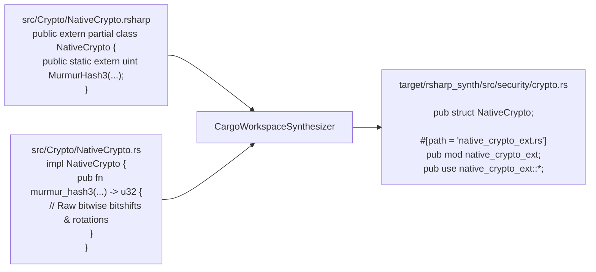

# Under the Hood of RustSharp: Blog 10
# Two-Way Interop — Linking Native Rust with extern partial

> *Part 10 of the 12-part technical series "Under the Hood of RustSharp: From C# Ergonomics to Pure Zero-Cost Rust"*

---

## 1. The Escape Hatch: Why High-Level Languages Need Raw Systems Code

No matter how advanced a transpiler or programming language is, real-world systems software inevitably encounters situations where developers must drop down to bare metal:
- Hand-optimized AVX-512 SIMD vectorization.
- Low-level network socket manipulation with raw POSIX `io_uring` or `epoll` syscalls.
- Inline assembly or lock-free atomics (`AtomicU64::fetch_add`).
- Reusing existing high-performance Rust crates (such as `ring`, `tokio`, or `axum`).

Most high-level languages force you to write C FFI wrappers with dynamic libraries (`.so` / `.dll`), marshaling data back and forth across heavy boundary layers.

RustSharp provides a **seamless two-way escape hatch**:
1. **Forward Interop:** Declare `extern partial` methods in `.rsharp` and implement them directly in a co-located `.rs` file in the same directory.
2. **Reverse Interop (`rsharp-bindgen`):** Point the built-in bindgen CLI at any existing Rust crate to automatically generate `.d.rsharp` ambient headers.

In this post, we explore how forward and reverse interop are implemented in [`src/codegen/cargo_synthesizer.rs`](file:///home/abhijit/Videos/transpilers/RustSharp/src/codegen/cargo_synthesizer.rs) and [`src/bindgen/crate_analyzer.rs`](file:///home/abhijit/Videos/transpilers/RustSharp/src/bindgen/crate_analyzer.rs).

---

## 2. Forward Interop: The `extern partial` Pattern

To write native Rust directly within your RustSharp project, place a raw `.rs` file side-by-side with your `.rsharp` file using the exact same stem name:

```text
src/
├── Crypto/
│   ├── NativeCrypto.rsharp  # High-level C# contract
│   └── NativeCrypto.rs      # Raw Rust implementation
```



### The C# Contract (`NativeCrypto.rsharp`)
```csharp
namespace Security.Crypto;

public extern partial class NativeCrypto {
    public static extern uint MurmurHash3(uint key, uint seed);
    public static extern bool ConstantTimeEqual(uint a, uint b);
}
```

### The Native Rust Implementation (`NativeCrypto.rs`)
```rust
use super::NativeCrypto;

impl NativeCrypto {
    pub fn murmur_hash3(mut k: u32, seed: u32) -> u32 {
        k = k.wrapping_mul(0xcc9e2d51);
        k = k.rotate_left(15);
        k = k.wrapping_mul(0x1b873593);

        let mut h = seed ^ k;
        h = h.rotate_left(13);
        h = h.wrapping_mul(5).wrapping_add(0xe6546b64);
        h ^= 4;
        h ^= h >> 16;
        h = h.wrapping_mul(0x85ebca6b);
        h ^= h >> 13;
        h = h.wrapping_mul(0xc2b2ae35);
        h ^= h >> 16;
        h
    }

    pub fn constant_time_equal(a: u32, b: u32) -> bool {
        (a ^ b) == 0
    }
}
```

### How the Compiler Links Them in Pass 3:
1. `rsharpc` discovers `NativeCrypto.rs` co-located with `NativeCrypto.rsharp`.
2. It emits the struct declaration `pub struct NativeCrypto;` in the generated namespace module (`src/security/crypto.rs`).
3. It links the co-located file as a submodule:
   ```rust
   #[path = "native_crypto_ext.rs"]
   pub mod native_crypto_ext;
   ```
4. Because `NativeCrypto.rs` defines inherent methods on `super::NativeCrypto`, any other `.rsharp` code in the workspace can call `NativeCrypto.MurmurHash3(key, seed)` as if it were pure C#!

No FFI shims. No C ABI overhead. The C# code and native Rust code compile together in the same compilation unit, allowing LLVM to inline the native Rust functions directly into the calling C# logic.

---

## 3. Reverse Interop: The `rsharp-bindgen` Tool

What if you have an existing Rust library (e.g. an image processing crate, cryptography crate, or custom network protocol) and you want to use it from RustSharp?

Instead of writing ambient C# stubs by hand, RustSharp includes a built-in generator: **`rsharp-bindgen`**.

```bash
# Run bindgen on an existing native Rust crate
rsharpc bindgen path/to/crate --namespace Native.Crypto --out CryptoBindings.d.rsharp
```

### How `rsharp-bindgen` Analyzes Rust Code:
Implemented in [`src/bindgen/crate_analyzer.rs`](file:///home/abhijit/Videos/transpilers/RustSharp/src/bindgen/crate_analyzer.rs), the bindgen engine:
1. Locates `Cargo.toml` and reads the crate name and dependencies.
2. Parses `src/lib.rs` and all submodules into an AST using RustSharp's internal Rust AST parser.
3. Extracts all public structs, enums, inherent `impl` blocks, and trait definitions.
4. Generates an ambient `.d.rsharp` header file mapping Rust types to C# equivalents:
   - `&str` &rarr; `[Borrows] string`
   - `&mut [u8]` &rarr; `[MutBorrows] Span<byte>`
   - `Result<T, E>` &rarr; `T throws E`
   - `Option<T>` &rarr; `T?`

### Example Generated Header:
```csharp
// Auto-generated by rsharp-bindgen from crate 'ring'
namespace Security.Native;

[MapsTo("ring::digest")]
public static class RingDigest {
    [InlineTemplate("ring::digest::digest(&ring::digest::SHA256, {0})")]
    public static extern ReadOnlySpan<byte> Sha256([Borrows] ReadOnlySpan<byte> data);
}
```

Developers can immediately import `using Security.Native;` and call `RingDigest.Sha256(data)` with full IDE auto-completion and type safety.

---

## 4. Summary & What's Next

Two-way interop gives systems developers total freedom:
- **`extern partial`:** Write hand-tuned, bare-metal Rust functions directly inside your C# project without FFI.
- **`rsharp-bindgen`:** Instantly consume existing Rust crates in the Cargo ecosystem via auto-generated ambient stubs.
- **Zero Runtime Tax:** Calls are statically linked and inlined by the compiler.

In **[Blog 11: Developer Experience — Synthesizing Cargo Workspaces and Bidirectional SourceMaps](11_developer_experience_synthesizing_cargo_and_sourcemaps.md)**, we examine the build engine: how RustSharp creates turn-key Cargo projects and maps `rustc` compiler errors back to C# source code.

