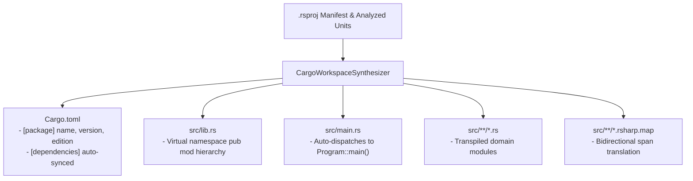

# Under the Hood of RustSharp: Blog 11
# Developer Experience — Synthesizing Cargo Workspaces and Bidirectional SourceMaps

> *Part 11 of the 12-part technical series "Under the Hood of RustSharp: From C# Ergonomics to Pure Zero-Cost Rust"*

---

## 1. The Output Problem: Generating Real Systems Projects

A compiler is only as good as the artifacts it produces. Many experimental transpilers stop after outputting a single messy `.c` or `.rs` file into stdout, leaving the developer stranded with missing build scripts, broken dependencies, and unresolvable compiler paths.

To be truly production-ready, **RustSharp (`rsharpc`) operates as a complete systems build system**. When pointed at a `.rsproj` project manifest, it:
1. Validates all semantic rules in memory.
2. Synthesizes a 100% compliant, standalone **Cargo crate** in `target/rsharp_synth/`.
3. Injects all required third-party crate dependencies into `Cargo.toml`.
4. Writes bidirectional source maps (`.rsharp.map`) to translate `rustc` compiler errors.
5. Invokes native `cargo check`, `cargo build`, or `cargo run`.

In this post, we look under the hood of [`src/codegen/cargo_synthesizer.rs`](file:///home/abhijit/Videos/transpilers/RustSharp/src/codegen/cargo_synthesizer.rs) and the `rsharpc` CLI toolchain.

---

## 2. The `.rsproj` Project File: Clean Declarative Metadata

RustSharp projects are defined using clean, XML-based `.rsproj` files (compatible with standard .NET project structure):

```xml
<Project Sdk="RustSharp.Sdk/0.1.0">
  <PropertyGroup>
    <PackageName>crypto_interop</PackageName>
    <Version>0.1.0</Version>
    <Edition>2021</Edition>
  </PropertyGroup>

  <ItemGroup>
    <CargoDependency Include="rust_decimal" Version="1.36" />
    <CargoDependency Include="serde" Version="1.0" Features="derive" />
  </ItemGroup>
</Project>
```

When `rsharpc` loads this project file:
- It configures the target crate package name and Rust edition.
- It automatically resolves co-located `.rs` files and subfolders.
- It merges custom `<CargoDependency>` entries with auto-detected ambient dependencies (e.g. `axum`, `tokio`, `rust_decimal`).

---

## 3. The Cargo Workspace Synthesizer

In Pass 3, the `CargoWorkspaceSynthesizer` transforms the in-memory AST and virtual namespace plans into a disk workspace:

```text
target/rsharp_synth/
├── Cargo.toml               # Synthesized manifest
├── src/
│   ├── lib.rs               # Virtual namespace module tree
│   ├── main.rs              # Auto-generated entrypoint (if Program.Main exists)
│   ├── security/
│   │   ├── crypto.rs        # Transpiled Rust code
│   │   ├── crypto.rs.rsharp.map # Bidirectional line map
│   │   └── native_crypto_ext.rs # Linked co-located Rust implementation
```



### Automatic Entrypoint Detection (`Main`)
If any class in the project declares a `public static void Main()`, the synthesizer detects it and emits a dedicated `src/main.rs`:

```rust
// Auto-generated by rsharpc entrypoint
fn main() {
    crypto_interop::security::crypto::Program::main();
}
```

Because Cargo automatically compiles both `src/lib.rs` and `src/main.rs`, the synthesized crate works seamlessly as both a reusable library and an executable binary!

---

## 4. Bidirectional SourceMaps: Translating Native Compiler Errors

One of the worst experiences in cross-language transpilation is receiving a compiler error pointing to generated code:
```text
error[E0308]: mismatched types
  --> target/rsharp_synth/src/security/crypto.rs:42:19
   |
42 |         let hash = NativeCrypto::murmur_hash3(key, "invalid_seed");
   |                                                    ^^^^^^^^^^^^^^ expected `u32`, found `&str`
```

How does the developer find line 42 of `crypto.rs` inside their original C# source files?

RustSharp generates a companion **`.rsharp.map`** file for every emitted module:

```text
src/security/crypto.rs:14 => src/CryptoService.rsharp:11:9
src/security/crypto.rs:20 => src/CryptoService.rsharp:17:16
src/security/crypto.rs:42 => src/CryptoService.rsharp:35:48
```

The `RustSourceMap` parser in [`src/codegen/sourcemap.rs`](file:///home/abhijit/Videos/transpilers/RustSharp/src/codegen/sourcemap.rs) intercepts `rustc` stderr output, parses error spans matching `--> <file>:<line>:<col>`, and rewrites them in real time:

```text
Compilation Error: Mismatched types
  --> src/CryptoService.rsharp:35:48
   |
35 |         var hash = NativeCrypto.MurmurHash3(key, "invalid_seed");
   |                                                  ^^^^^^^^^^^^^^ expected uint, found string
```

Developers debug their original `.rsharp` files without ever needing to inspect generated code.

---

## 5. The `rsharpc` CLI Suite

RustSharp provides a fast, integrated CLI:

```bash
# 1. In-Memory Verification (Pass 1 - Pass 2.5)
rsharpc check path/to/Project.rsproj

# 2. Emit Rust Code & SourceMaps without building
rsharpc emit-rs path/to/Project.rsproj

# 3. Synthesize and run `cargo check`
rsharpc build path/to/Project.rsproj

# 4. Synthesize and execute immediately (`cargo run` or `cargo test`)
rsharpc run path/to/Project.rsproj

# 5. Continuous File Watcher with live recompilation
rsharpc watch path/to/Project.rsproj

# 6. Generate Ambient C# Stubs from a native Rust crate
rsharpc bindgen path/to/native-crate --namespace Crate.Bindings
```

### High-Throughput Performance
Because the entire compiler is built in pure Rust without external dependency overhead:
- Full compilation through Pass 1, 2, 2.5, and 3 takes **under 0.05 seconds** for typical multi-file projects.
- Throughput benchmarks achieve **over 250,000 lines per second**.

---

## 6. Summary & What's Next

The developer experience of RustSharp bridges the gap between enterprise C# and systems Rust:
- Declarative `.rsproj` manifests eliminate build script maintenance.
- Turn-key Cargo workspaces are synthesized on demand.
- Bidirectional source maps make native compiler errors effortless to diagnose.

In our final post, **[Blog 12: IDE Superpowers — Inside the Pure-Rust Language Server (LSP)](12_ide_superpowers_inside_the_pure_rust_lsp_server.md)**, we explore how we built a zero-dependency Language Server Protocol (LSP) implementation powering live diagnostics, hover borrow inspection, and cross-file Go to Definition in VS Code.

