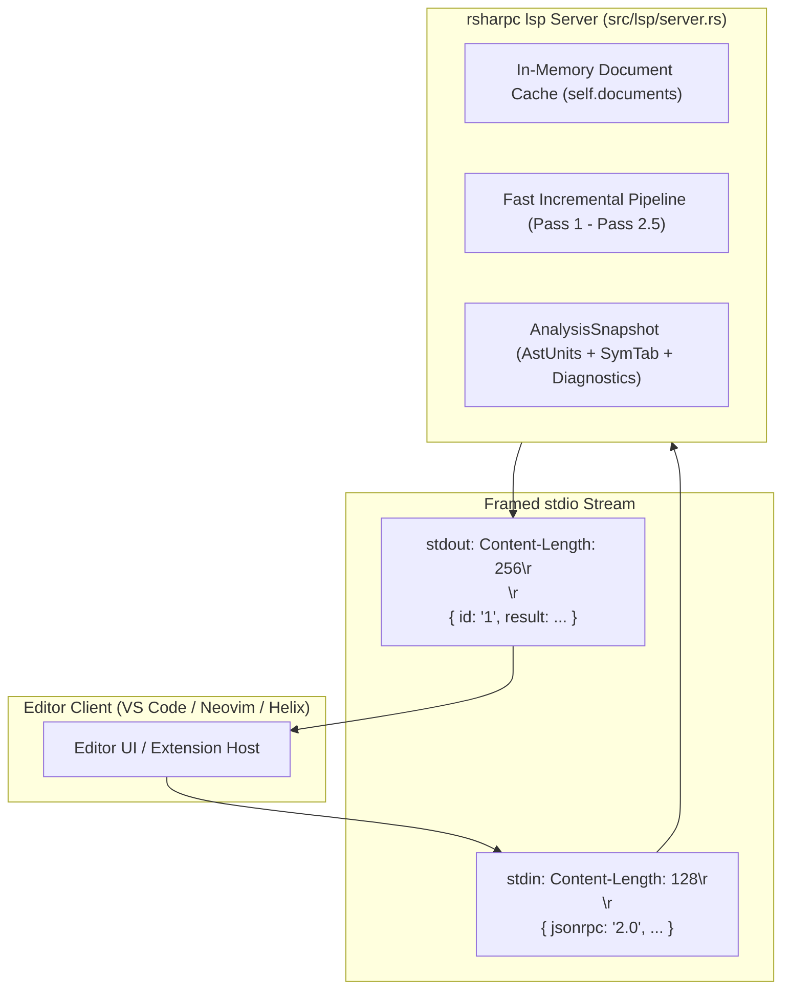
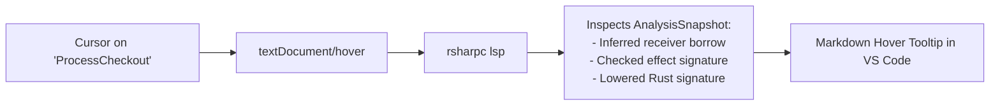

# Under the Hood of RustSharp: Blog 12
# IDE Superpowers — Inside the Pure-Rust Language Server (LSP)

> *Part 12 of the 12-part technical series "Under the Hood of RustSharp: From C# Ergonomics to Pure Zero-Cost Rust"*

---

## 1. The Language Server Imperative

In modern software development, a programming language without first-class IDE support is dead on arrival. Developers expect:
- Real-time syntax highlighting that recognizes language nuances.
- As-you-type diagnostics catching ownership errors before compiling.
- Rich hover tooltips revealing inferred types and lowered signatures.
- Instant, accurate cross-file and native Go to Definition (`F12`).
- Auto-completion for keywords, methods, and LINQ pipelines.

However, many language servers rely on heavy Node.js or Python daemons with hundreds of megabytes of `node_modules` dependencies.

In keeping with RustSharp's core philosophy (**Decision D-013**), the **RustSharp Language Server (`rsharpc lsp`) is implemented in 100% pure standard library Rust (`std`) with zero external crates**. It communicates over standard input/output (`stdio`) via JSON-RPC 2.0 and powers rich language intelligence in VS Code, Neovim, and Helix.

In this concluding post, we explore how [`src/lsp/server.rs`](file:///home/abhijit/Videos/transpilers/RustSharp/src/lsp/server.rs) and [`editors/code/`](file:///home/abhijit/Videos/transpilers/RustSharp/editors/code/) turn complex compiler mechanics into an effortless developer experience.

---

## 2. Architecture: Pure-Rust JSON-RPC 2.0 on `stdio`

The LSP protocol is built on JSON-RPC 2.0 framed with HTTP-style headers (`Content-Length: <bytes>\r\n\r\n<json>`).

The RustSharp transport in [`src/lsp/jsonrpc.rs`](file:///home/abhijit/Videos/transpilers/RustSharp/src/lsp/jsonrpc.rs) implements streaming message framing, custom UTF-8 JSON extraction, and message dispatch using only `std::io::BufReader`, `std::io::BufWriter`, and `std::collections::HashMap`:



### The In-Memory Virtual File System
When a user edits a file in VS Code:
1. VS Code sends `textDocument/didChange` containing the dirty in-memory text.
2. The LSP updates `self.documents`.
3. It immediately triggers an incremental re-analysis of the workspace:
   - Evaluates Pass 1 (type declarations and virtual namespaces).
   - Evaluates Pass 2 (symbol binding).
   - Evaluates Pass 2.5 (borrow inference and preflight ownership rules).
4. Emits `textDocument/publishDiagnostics` to display red squiggles in the editor in under **10 milliseconds**.

---

## 3. The Borrow Inspector: Real-Time Hover Tooltips

The killer feature of the RustSharp LSP is the **Real-Time Borrow Inspector**.

Because RustSharp infers `&self` vs `&mut self` and `&T` vs `&mut T` automatically, developers often want to know: *"Did the compiler infer this method as an immutable borrow or a mutating borrow?"*

When you hover over any method in your code:



### The Rendered Markdown Tooltip:
```markdown
```rustsharp
(method) Order CheckoutService.ProcessCheckout(string orderId)
```

**Lowered Rust signature:**
```rust
pub fn process_checkout(&self, order_id: &str) -> Order
```

*Inferred receiver borrow:* `&self` (whole-program mutation analysis)
```

If the method mutates state:
```markdown
*Inferred receiver borrow:* `&mut self` (mutation detected on field 'this.orders')
```

If the method declares checked effects:
```markdown
*Checked effect:* `throws ValidationError` (lowered to `Result<Order, ValidationError>`)
```

Developers get instant, transparent insight into how the compiler views their memory access patterns without having to read generated Rust code.

---

## 4. Cross-File and Native Go to Definition (`F12`)

Navigating complex domain models requires jumping seamlessly across files. RustSharp's definition provider in [`src/lsp/server.rs`](file:///home/abhijit/Videos/transpilers/RustSharp/src/lsp/server.rs) resolves symbols across:
1. **Local Variables & Parameters:** Jumps to the exact variable binding within the method.
2. **Type Members:** Jumps to fields, properties, or methods within the enclosing class.
3. **Cross-File Declarations:** Jumps across arbitrary files in the virtual namespace.
4. **Co-located Native Rust Files:** If you press `F12` on `NativeCrypto.MurmurHash3`, the LSP scans the sibling `NativeCrypto.rs` file and jumps directly to `pub fn murmur_hash3` in raw Rust!

### The Exact-Identifier Range Technique
In early LSP implementations, returning the full multi-line AST span of a method (e.g. lines 10..25) caused VS Code to suppress definition jumps if the cursor was already within the method.

RustSharp constrains all definition ranges to the exact token identifier:
```rust
let (start_l, start_c, end_l, end_c) = (
    span.start_line.saturating_sub(1),
    span.start_col.saturating_sub(1),
    span.start_line.saturating_sub(1),
    span.start_col.saturating_sub(1) + ident.len() as u32,
);
```
This guarantees an instant, pinpoint cursor jump in VS Code every time.

---

## 5. The Zero-Dependency VS Code Extension

The official RustSharp extension in [`editors/code/`](file:///home/abhijit/Videos/transpilers/RustSharp/editors/code/) contains **zero npm dependencies**. It uses only standard VS Code APIs and Node's built-in `child_process`:

- **Syntax Grammar (`rustsharp.tmLanguage.json`):** Beautiful syntax coloring for records, service classes, LINQ keywords, interpolated strings `$"{expr}"`, verbatim strings, and decimal literals.
- **Auto Server Discovery:** Searches `target/release/rsharpc`, `target/debug/rsharpc`, or `PATH`.
- **Command Palette Integration:** Includes `RustSharp: Restart Language Server` (`rustsharp.restartServer`) for hot-reloading the LSP after compiler rebuilds.

```bash
# Install the extension into your local VS Code / Antigravity setup:
ln -s "$(pwd)/editors/code" ~/.vscode/extensions/rustsharp-0.1.0
```

---

## 6. The Journey Complete: C# Ergonomics + Bare-Metal Rust

Over this 12-part technical journey, we have explored the complete design of the RustSharp compiler:
- **Module 1:** The vision, UTF-8 lexer, Pratt parser, and virtual namespaces.
- **Module 2:** Static overload monomorphization, interprocedural borrow inference, and zero-cost polymorphism.
- **Module 3:** Checked effects (`throws E`), fused LINQ iterator pipelines, and ambient stubs.
- **Module 4:** Two-way native Rust interop, Cargo workspace synthesis, and our pure-Rust Language Server.

RustSharp proves that the tension between enterprise developer ergonomics and bare-metal systems performance is not an immutable law of computer science. With compile-time semantic analysis, borrow inference, and zero-cost abstractions, **we can write software with the elegance of C# and execute it with the raw, uncompromising power of pure Rust**.

Thank you for reading the series! Happy systems hacking!

