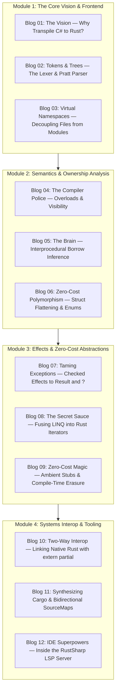

# Under the Hood of RustSharp: From C# Ergonomics to Pure Zero-Cost Rust

## Master Blog Series Plan & Technical Curriculum

This 12-part educational series documents the architecture, computer science principles, and implementation details behind the **RustSharp (`rsharpc`)** compiler. It takes readers from the fundamental theory of programming language memory models to a production-ready, multi-pass compiler emitting verified, zero-cost Rust code.

---

## 🗺️ Curriculum Overview

---

## 📚 Detailed Post Breakdown

### Module 1: The Core Vision & Frontend

#### [Blog 01: The Vision — Why Transpile C# to Zero-Cost Rust?](01_the_vision_why_transpile_csharp_to_rust.md)
- **The Problem:** The tension between C#'s enterprise ergonomics and Rust's bare-metal performance.
- **The Semantic Chasm:** Why naive transpilation fails (GC vs Single Ownership, Inheritance vs Traits, Exceptions vs Results).
- **The Solution:** The Three Type Archetypes (`record`/`struct`, `service class`, `shared class`) and compile-time borrow inference.

#### [Blog 02: Tokens & Trees — The UTF-8 Lexer and Pratt Expression Parser](02_tokens_and_trees_the_lexer_and_pratt_parser.md)
- **Lexical Scanning:** Handling string interpolation `$"..."`, decimal literals `10.0m`, and operators (`..`, `??`, `?.`).
- **Pratt Parsing in Rust:** Binding power and operator precedence from null-coalescing to primary postfix calls.
- **Multi-Pass AST Design:** Why interior semantic decoration slots beat allocating distinct trees per pass.

#### [Blog 03: Virtual Namespaces — Freeing Code from the Physical File System](03_virtual_namespaces_freeing_code_from_files.md)
- **The Ergonomic Bottleneck:** How Rust's rigid file-module hierarchy slows down large-scale domain refactoring.
- **Virtual Namespace Aggregation:** Merging declarations across arbitrary directories into unified modules.
- **Solving Circular References:** Handling bidirectional type dependencies across files in Pass 1.

---

### Module 2: Semantics & Ownership Analysis

#### [Blog 04: The Compiler Police — Static Overload Monomorphization & Encapsulation](04_the_compiler_police_overloads_and_visibility.md)
- **The Overload Conflict:** Rust `impl` blocks forbid methods sharing the same identifier.
- **Compile-Time Monomorphization:** Resolving method and constructor overloads statically with zero runtime cost.
- **Enforcing Visibility:** Mapping `public`, `internal`, `private`, and `protected` to Rust visibility rules.

#### [Blog 05: The Brain — Interprocedural Escape & Mutation Analysis](05_the_brain_interprocedural_borrow_inference.md)
- **The Crown Jewel:** How RustSharp infers `&self`/`&mut self` and `&T`/`&mut T` without lifetime annotations (`'a`).
- **Call Graph Traversal:** Tracking field writes and escaping allocations across function boundaries.
- **Caller-Site Mutation Injection:** Automatically rewriting caller statements to insert `let mut` and `&mut`.

#### [Blog 06: Zero-Cost Polymorphism — Struct Flattening, Deref, and Closed Enum Dispatch](06_zero_cost_polymorphism_struct_flattening_and_enums.md)
- **Inheritance Without Vtables:** Flattening base structs and implementing `Deref` / `DerefMut`.
- **Closed-World Hierarchies:** Turning internal `abstract class` hierarchies into tagged unions (`enum`) with exhaustive `match`.
- **Open Polymorphism:** Lowering `extensible interface` into native Rust traits.

---

### Module 3: Effects & Zero-Cost Abstractions

#### [Blog 07: Taming the Exception Monster — Checked Effects to Result<T, E> and ?](07_taming_exceptions_checked_effects_to_result_and_try.md)
- **Exceptions vs Monads:** The performance penalty and safety risks of stack unwinding.
- **Static Effect System:** How `throws E` enforces compile-time handling while generating idiomatic `Result<T, E>`.
- **Lowering `throw` and `try-catch`:** Transforming control flow into Rust pattern matches.

#### [Blog 08: The Secret Sauce — Fusing LINQ into Zero-Cost Rust Iterators](08_the_secret_sauce_fusing_linq_into_rust_iterators.md)
- **The LINQ Promise:** Writing declarative queries without allocating intermediate arrays.
- **AST Pattern Fusing:** Collapsing `.Where().Select().ToList()` into `.iter().filter().map().collect()`.
- **Short-Circuit Evaluation:** Mapping `.Any()`, `.All()`, and `.First()` to lazy iterator adaptors.

#### [Blog 09: Zero-Cost Magic — Ambient Stubs and Compile-Time Erasure](09_zero_cost_magic_ambient_stubs_and_compile_time_erasure.md)
- **What is an Ambient Stub?** Inside `stdlib/RustSharp.Core.d.rsharp`.
- **Compiler Directives:** Using `[MapsTo]`, `[ParamType]`, `[InlineTemplate]`, and `[Moves]`.
- **Zero Runtime Tax:** Compiling C# primitives directly to native Rust types without wrapper classes.

---

### Module 4: Systems Interop & Tooling

#### [Blog 10: Two-Way Interop — Linking Native Rust with extern partial](10_two_way_interop_linking_native_rust_with_extern_partial.md)
- **The Escape Hatch:** Why real-world systems need raw Rust (SIMD, assembly, unsafe pointers).
- **The `extern partial` Contract:** Linking `.rsharp` declarations to co-located `.rs` modules.
- **Integrating Crates:** Calling external crates via `extern using`.

#### [Blog 11: Developer Experience — Synthesizing Cargo Workspaces and Bidirectional SourceMaps](11_developer_experience_synthesizing_cargo_and_sourcemaps.md)
- **Automated Cargo Synthesis:** Emitting turn-key `Cargo.toml` manifests and `src/lib.rs` trees.
- **Debugging Transpiled Code:** Mapping native compiler errors and stack traces back to original `.rsharp` lines.
- **The `rsharpc` CLI:** Building, checking, and running projects in one command.

#### [Blog 12: IDE Superpowers — Inside the Pure-Rust Language Server (LSP)](12_ide_superpowers_inside_the_pure_rust_lsp_server.md)
- **Architecting the Language Server:** JSON-RPC 2.0 communication and in-memory virtual file systems.
- **The Borrow Inspector:** Revealing inferred `&T` vs `&mut T` in real-time hover tooltips.
- **Editor Integration:** Setting up VS Code, Neovim, and Helix.

---

## 🎯 Target Audience & Prerequisites

- **Systems Engineers:** Wanting to see how high-level typing and borrow checking intersect.
- **C# / .NET Developers:** Curious about how C# constructs translate into bare-metal Rust.
- **Compiler Enthusiasts:** Looking for a practical, step-by-step case study in multi-pass compiler construction.

